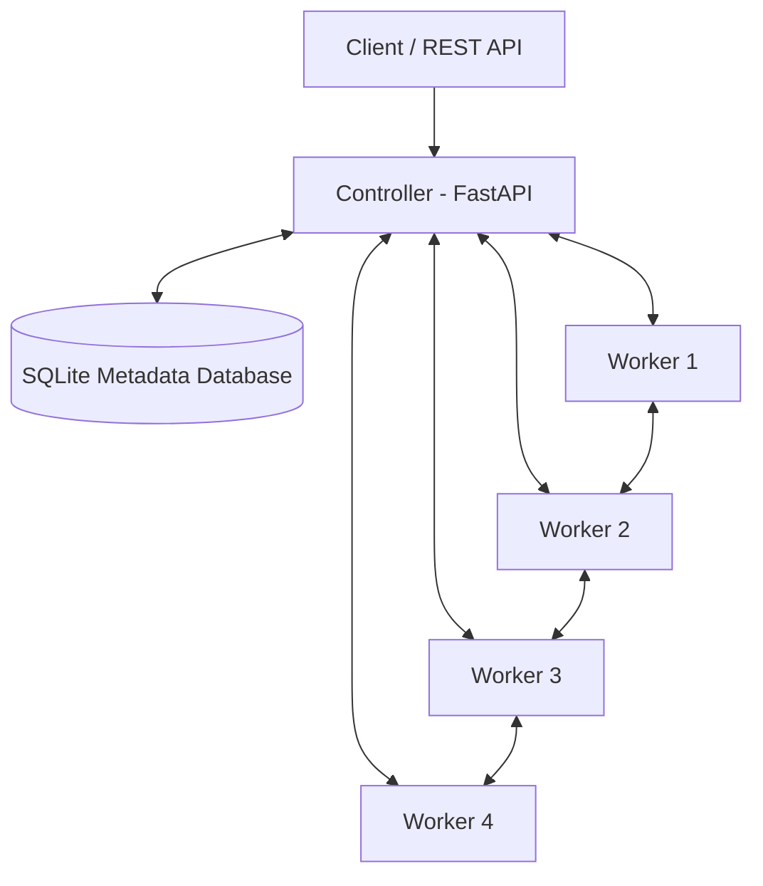

# Mini Cloud Object Store

A distributed cloud object storage system built using **Python, FastAPI, Docker, and SQLite**. The system stores files as smaller chunks, distributes them across multiple storage workers, maintains replicas for fault tolerance, and automatically repairs missing replicas when a worker fails.

## Overview

Mini Cloud Object Store is a simplified implementation of a distributed object storage system inspired by cloud storage services.

Instead of storing an entire file on a single machine, the system divides files into smaller chunks and distributes them across multiple worker nodes. Each chunk is replicated across two different workers to improve data availability and fault tolerance.

A central Controller manages file operations, worker coordination, metadata, and replica management.

## Key Features

- **Distributed Storage:** Files are divided into 1 MB chunks and distributed across multiple storage workers.
- **Data Replication:** Each chunk is stored with a replication factor of 2.
- **Fault Tolerance:** The system can retrieve data from a replica when the primary worker becomes unavailable.
- **Automatic Replica Repair:** Missing or invalid replicas are detected and recreated on healthy workers.
- **Metadata Management:** Stores object information and supports metadata retrieval and updates.
- **Persistent Metadata:** SQLite maintains object and chunk metadata across Controller restarts.
- **Data Integrity:** SHA-256 checksums are used to verify chunk and reconstructed file integrity.
- **REST API:** FastAPI provides endpoints for uploading, downloading, listing, updating metadata, and deleting objects.
- **Containerized Deployment:** Docker Compose runs the Controller and four storage workers.

## Architecture

The system consists of five Docker containers:

1. **Controller:** Coordinates uploads, downloads, worker registration, metadata management, and replica repair.
2. **Worker 1:** Stores distributed file chunks.
3. **Worker 2:** Stores distributed file chunks.
4. **Worker 3:** Stores distributed file chunks.
5. **Worker 4:** Stores distributed file chunks.

SQLite is used by the Controller to persist object and chunk metadata.

### Architecture Diagram



### File Upload Workflow

1. The client uploads a file to the Controller.
2. The Controller divides the file into 1 MB chunks.
3. Each chunk is assigned a unique identifier.
4. Chunks are distributed across available workers.
5. Every chunk is replicated on a second worker.
6. Object and chunk location metadata is stored in SQLite.
7. The Controller returns the object identifier.

### File Download Workflow

1. The client requests an object using its object ID.
2. The Controller retrieves the chunk locations from SQLite.
3. It fetches each chunk from its primary worker.
4. If the primary copy is unavailable or invalid, it attempts to retrieve the replica.
5. The chunks are reconstructed into the original file.
6. SHA-256 verification ensures data integrity.

### Fault Tolerance and Replica Repair

The Controller monitors worker availability through periodic heartbeats.

When a worker becomes unavailable, the system can retrieve affected chunks from their replicas. A background repair process checks stored chunk copies and recreates missing replicas on healthy workers.

This helps maintain the configured replication factor and improves storage reliability.

## Technology Stack

| Technology | Purpose |
|---|---|
| Python | Backend development |
| FastAPI | REST API framework |
| SQLite | Persistent metadata storage |
| Docker | Containerization |
| Docker Compose | Multi-container orchestration |
| HTTPX | Communication between Controller and Workers |
| Uvicorn | ASGI server |
| SHA-256 | Data integrity verification |

## Project Structure

```text
mini-cloud-object-store/
│
├── controller/
│   ├── Dockerfile
│   ├── __init__.py
│   └── main.py
│
├── workers/
│   ├── Dockerfile
│   └── app/
│       ├── __init__.py
│       └── main.py
│
├── tests/
│   └── test_api.py
│
├── docs/
│   └── architecture.md
│
├── docker-compose.yml
├── requirements.txt
├── .dockerignore
└── .gitignore
```

## Getting Started

### Prerequisites

Make sure the following tools are installed:

- Python 3.12 or later
- Docker Desktop
- Docker Compose
- Git

### 1. Clone the Repository

```bash
git clone https://github.com/haneeshreddy9/mini-cloud-object-store.git
```

Navigate into the project directory:

```bash
cd mini-cloud-object-store
```

### 2. Start the Distributed Storage System

Build and start all containers:

```bash
docker compose up -d --build
```

This starts the Controller and four storage workers.

### 3. Verify the Containers

```bash
docker compose ps
```

Check the Controller health endpoint:

```bash
curl http://localhost:8000/health
```

The Controller API is available at:

```text
http://localhost:8000
```

Interactive API documentation is available at:

```text
http://localhost:8000/docs
```

## API Endpoints

The system exposes REST APIs for object and metadata management.

| Method | Endpoint | Description |
|---|---|---|
| GET | `/health` | Check Controller health |
| GET | `/internal/workers` | List registered workers |
| POST | `/api/v1/objects` | Upload an object |
| GET | `/api/v1/objects` | List stored objects |
| GET | `/api/v1/objects/{object_id}` | Download an object |
| DELETE | `/api/v1/objects/{object_id}` | Delete an object |
| GET | `/api/v1/objects/{object_id}/metadata` | Retrieve object metadata |
| PATCH | `/api/v1/objects/{object_id}/metadata` | Update object metadata |

### Example: Upload an Object

```bash
curl -X POST http://localhost:8000/api/v1/objects \
  -F "file=@sample.txt" \
  -F 'metadata={"owner":"Haneesh","project":"Cloud Storage"}'
```

The response provides an object ID that can be used for subsequent operations.

### Example: List Objects

```bash
curl http://localhost:8000/api/v1/objects
```

### Example: Download an Object

Replace `OBJECT_ID` with the ID returned during upload.

```bash
curl -o downloaded.txt \
  http://localhost:8000/api/v1/objects/OBJECT_ID
```

### Example: Retrieve Metadata

```bash
curl http://localhost:8000/api/v1/objects/OBJECT_ID/metadata
```

### Example: Update Metadata

```bash
curl -X PATCH \
  http://localhost:8000/api/v1/objects/OBJECT_ID/metadata \
  -H "Content-Type: application/json" \
  -d '{"department":"Computer Science"}'
```

### Example: Delete an Object

```bash
curl -X DELETE \
  http://localhost:8000/api/v1/objects/OBJECT_ID
```

## Testing

The project includes automated API tests using Python's `unittest` framework and HTTPX.

Run the test suite:

```bash
python3 -m unittest discover -s tests -v
```

The tests cover the object lifecycle, including:

- Object upload
- Object listing
- Metadata updates and retrieval
- Object download
- Data integrity verification
- Object deletion

Additional manual tests were performed to validate:

- Multi-chunk file uploads and downloads
- Replication across different workers
- Metadata persistence after Controller restart
- Failover when a storage worker becomes unavailable
- Automatic replica repair
- Successful retrieval after replica repair

## Data Persistence

The project uses Docker volume mounts to persist data:

- SQLite database files are stored in the `database/` directory.
- Worker chunk data is stored under `data/worker1/`, `data/worker2/`, `data/worker3/`, and `data/worker4/`.

These directories are generated during execution and are excluded from Git.

## Stopping the System

To stop all containers:

```bash
docker compose down
```

To stop containers and remove their associated named volumes:

```bash
docker compose down -v
```

Note: The second command can remove persistent Docker-managed volumes. The project's bind-mounted database and worker data directories should be managed separately.

## Learning Outcomes

This project demonstrates practical implementation of important distributed systems and cloud computing concepts:

- Distributed storage architecture
- Data partitioning and chunk distribution
- Data replication
- Fault tolerance and failover
- Heartbeat-based worker monitoring
- Automatic recovery and replica repair
- Metadata persistence
- RESTful API development
- Containerization and orchestration

## Future Improvements

- Dynamic worker scaling
- Consistent hashing for improved chunk placement
- Authentication and access control
- Cloud deployment on AWS, Azure, or Google Cloud
- Advanced monitoring and performance metrics
- Distributed metadata management

## Author

**Haneesh Reddy**

**Vivek**

GitHub: [@haneeshreddy9](https://github.com/haneeshreddy9)

Project Repository: [Mini Cloud Object Store](https://github.com/haneeshreddy9/mini-cloud-object-store)
