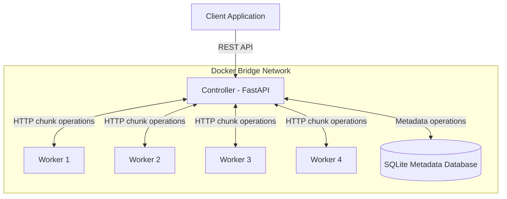

# System Architecture

## Main Components

- **Client:** Sends upload, download, listing, metadata and deletion requests.
- **Controller:** Handles API requests, chunking, placement, replication, failover and recovery.
- **Workers:** Store chunk files and respond to chunk operations.
- **SQLite:** Persists object metadata, chunk checksums and Worker assignments.

## Storage Strategy

- Chunk size: 1 MiB.
- Replication factor: 2.
- Placement: Round-robin across available Workers.
- Integrity: SHA-256 checksums.
- Worker monitoring: Periodic heartbeats.
- Recovery: Background replica repair process.
